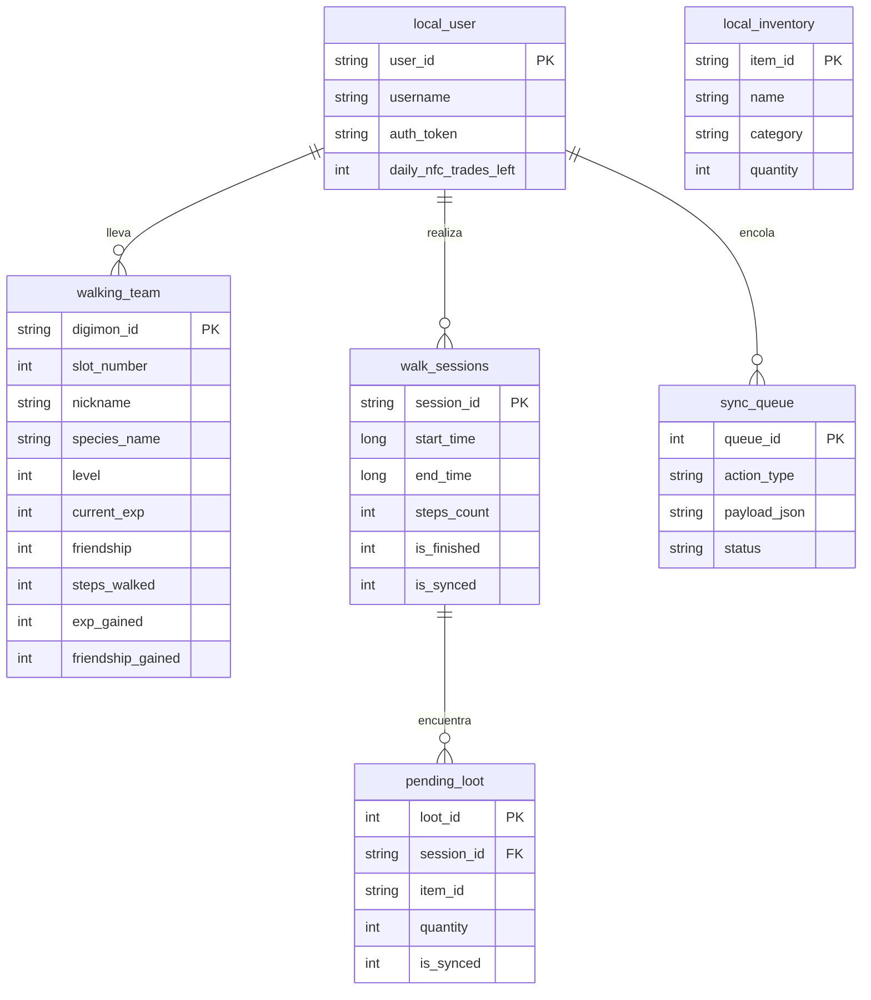

# DGWalker
### Aplicación Android Nativa: Exploración, Podómetro, Sensores y Modo Offline-First


> Repositorio oficial de la aplicación móvil **DGWalker** para el ecosistema DGHome.  
> Diseñada para permitir al entrenador llevar hasta a 3 Digimons de su granja a pasear por el mundo real, registrar pasos en segundo plano, eclosionar Digi-Huevos, encontrar botín e intercambiar criaturas presencialmente mediante tecnología **NFC**.

---

## 1. Visión y Funcionalidades Principales

DGWalker traduce la actividad física del usuario en progreso directo dentro del juego:

1. **Contador de Pasos en Tiempo Real (DigiSteps):**
   - Servicio en segundo plano (`Foreground Service`) con widget persistente en la barra de notificaciones para contar pasos incluso con la pantalla apagada o la app cerrada.
   - Cada hito de pasos otorga puntos de experiencia (EXP) y aumenta el nivel de amistad (*Bond*) del equipo de paseo.
2. **Arquitectura 100% Offline-First:**
   - La aplicación funciona plenamente **sin conexión a internet ni datos móviles**.
   - Pasos, subidas de nivel, amistad y objetos encontrados se almacenan de inmediato en la base de datos local **SQLite mediante Room**.
   - Al detectar red Wi-Fi o datos móviles, un proceso en segundo plano con **WorkManager** sincroniza automáticamente los datos con el servidor central.
3. **Incubación de Digi-Huevos:**
   - Huevos encontrados durante las caminatas que requieren un número determinado de pasos reales para eclosionar (con alertas y vibración háptica al eclosionar).
4. **Intercambio Presencial por NFC (1/día):**
   - Flujo en 3 pasos: selección de criatura, aproximación de los dos teléfonos por la parte trasera mediante **NFC (Host Card Emulation)** y confirmación mediante deslizador táctil de seguridad.
5. **Alternativa por Código QR Dinámico:**
   - Escáner con cámara para terminales que no cuenten con chip NFC físico.

---

## 2. Pantallas de la Aplicación

```
┌────────────────────────────────────────────────────────────────────────┐
│  DGWalker UI Flow                                                      │
├────────────────────────────────────────────────────────────────────────┤
│  [14. Login]  ──►  [15. Registro]  ──►  [16. Recuperar Contraseña]     │
│       │                                                                │
│       ▼                                                                │
│  [01. Home / DigiSteps Tracker] ◄─── Bottom Navigation Bar ──────────┐ │
│       ├──► [02. Detalle Digimon] ◄──► [03. Colección / Equipo 1-3]    │ │
│       ├──► [04. Mochila / Inventario (1670/2000)]                    │ │
│       ├──► [05. Perfil Entrenador] ──► [06. Amigos] ──► [07. Add]    │ │
│       ├──► [08. NFC Paso 1] ──► [09. Conexión] ──► [10. Confirmar]   │ │
│       │         │                      │                 │             │ │
│       │         └──────────────────────┴────────► [11. Finalizado]     │ │
│       │                                                  ▲             │ │
│       ├──► [12. Alternativa: Intercambio por QR] ────────┘             │ │
│       └──► [13. Ajustes: Sensores, Calibración, Room y Sincronización] │ │
└────────────────────────────────────────────────────────────────────────┘
```

---

## 3. Stack Tecnológico & Librerías de Android

- **Lenguaje:** Kotlin 1.9+ con Corrutinas y StateFlow para reactividad.
- **SDK Target:** Android 15 | **SDK Mínimo:** Android 8.0.
- **Interfaz de Usuario (UI):** Jetpack Compose con Material 3.
- **Inyección de Dependencias:** **Hilt** (`@HiltAndroidApp`, `@AndroidEntryPoint`, `@HiltViewModel`, módulos `@InstallIn(SingletonComponent::class)`).
- **Navegación:** Jetpack Compose Navigation **Type-Safe** mediante objetos y clases `@Serializable` en `Routes.kt`.
- **Persistencia Local (Offline-First):**
  - **Android Jetpack Room** (SQLite tipado para tablas de usuario, equipo, sesiones de paseo e inventario).
  - **Jetpack DataStore (Preferences):** Almacenamiento reactivo y moderno de preferencias del usuario (idioma ES/EN, calibración del podómetro, flags de vibración, notificaciones y tema visual).
- **Segundo Plano y Sincronización:**
  - `ForegroundService`: Mantiene el conteo de pasos activo con notificación persistente (`FOREGROUND_SERVICE_HEALTH`).
  - `WorkManager`: Tareas encoladas de sincronización periódica con restricciones de red (`NetworkType.CONNECTED`).
- **Hardware & Sensores:**
  - `SensorManager` con `Sensor.TYPE_STEP_COUNTER` y `Sensor.TYPE_STEP_DETECTOR`.
  - `NfcAdapter` con soporte para Host Card Emulation (HCE) y lectura NDEF.
  - `CameraX` / `ZXing Embedded` para lectura y generación de códigos QR de intercambio.
- **Red & API REST:** Retrofit 2 (o Ktor Client) + OkHttp 4 + Moshi / KotlinX Serialization.
- **Localización e Idiomas:** Soporte bilingüe completo en Español e Inglés (`values/strings.xml` y `values-en/strings.xml`).
- **Intents Implícitos:** Compartir logros de paseo y estadísticas del Digimon con otras aplicaciones instaladas.

---

## 4. Base de Datos Local: Entidades Room (SQLite)

Para soportar el funcionamiento sin internet, la base de datos local almacena las siguientes tablas:



---

## 5. Permisos Requeridos (`AndroidManifest.xml`)

La aplicación declara los siguientes permisos de sistema para interactuar con los sensores de hardware:

```xml
<manifest xmlns:android="http://schemas.android.com/apk/res/android">
    <!-- Podómetro y Actividad Física -->
    <uses-permission android:name="android.permission.ACTIVITY_RECOGNITION" />
    <uses-permission android:name="android.permission.FOREGROUND_SERVICE" />
    <uses-permission android:name="android.permission.FOREGROUND_SERVICE_HEALTH" />

    <!-- Sensor NFC e Intercambio -->
    <uses-feature android:name="android.hardware.nfc" android:required="false" />
    <uses-permission android:name="android.permission.NFC" />

    <!-- Conectividad y Sincronización -->
    <uses-permission android:name="android.permission.INTERNET" />
    <uses-permission android:name="android.permission.ACCESS_NETWORK_STATE" />

    <!-- Notificaciones y Respuesta Háptica -->
    <uses-permission android:name="android.permission.POST_NOTIFICATIONS" />
    <uses-permission android:name="android.permission.VIBRATE" />

    <!-- Cámara para Códigos QR -->
    <uses-permission android:name="android.permission.CAMERA" />
</manifest>
```

---

## 6. Estructura de Carpetas del Proyecto (Feature-Driven Architecture)

La arquitectura sigue el patrón modular orientado a funcionalidades (*Feature-Driven*) con inyección de dependencias mediante **Hilt** y navegación **Type-Safe**:

```
app/
├── src/
│   ├── main/
│   │   ├── AndroidManifest.xml
│   │   └── java/com/dgproject/dgwalker/
│   │       ├── MainApplication.kt             # Define @HiltAndroidApp
│   │       ├── MainActivity.kt                # Punto de entrada, @AndroidEntryPoint
│   │       │
│   │       ├── core/                          # Código compartido global (no atado a una única feature)
│   │       │   ├── data/                      # Repositorios compartidos y persistencia
│   │       │   │   ├── local/                 # Room Database (Entities, DAOs) y DataStore
│   │       │   │   ├── remote/                # Configuración global de Retrofit / Ktor
│   │       │   │   └── repository/            # Implementaciones de repositorios comunes
│   │       │   ├── di/                        # Módulos de Hilt para dependencias globales
│   │       │   │   ├── DatabaseModule.kt      # Provee instancias de Room y DataStore
│   │       │   │   └── NetworkModule.kt       # Provee cliente OkHttp, Retrofit y APIs
│   │       │   ├── hardware/                  # Controladores de sensores y hardware
│   │       │   │   ├── sensors/               # Podómetro (SensorManager) y StepDetector
│   │       │   │   ├── nfc/                   # Host Card Emulation (HCE) y lectura NFC
│   │       │   │   └── qr/                    # Generador y escáner de códigos QR
│   │       │   ├── navigation/                # Configuración y grafos de navegación global
│   │       │   │   ├── AppNavHost.kt          # Contiene el NavHost principal de Compose
│   │       │   │   └── Routes.kt              # Clases y objetos @Serializable para navegación Type-Safe
│   │       │   ├── service/                   # Servicios en segundo plano
│   │       │   │   ├── StepCounterService.kt  # Foreground Service con notificación permanente
│   │       │   │   └── SyncWorker.kt          # WorkManager CoroutineWorker para sincronización
│   │       │   └── ui/                        # Diseño del sistema y componentes reutilizables
│   │       │       ├── theme/                 # Color.kt, Type.kt, Theme.kt (Dark Cyberpunk)
│   │       │       └── components/            # Botones, barras de carga comunes, diálogos
│   │       │
│   │       └── features/                      # Directorio de funcionalidades (Feature-Driven)
│   │           ├── auth/                      # Feature: Autenticación (Login, Registro, Recovery)
│   │           │   ├── data/                  # Lógica de datos específica de auth
│   │           │   ├── di/                    # Módulo Hilt específico de auth (opcional)
│   │           │   ├── domain/                # Casos de uso o modelos específicos
│   │           │   └── presentation/          # Capa de UI Compose
│   │           │       ├── LoginScreen.kt     # Composable de la pantalla de login
│   │           │       └── LoginViewModel.kt  # @HiltViewModel con estado de la pantalla
│   │           │
│   │           ├── home/                      # Feature: Pantalla principal de paseo y DigiSteps
│   │           │   ├── data/
│   │           │   ├── domain/
│   │           │   └── presentation/
│   │           │       ├── HomeScreen.kt      # Contador de pasos en vivo y sprite animado
│   │           │       └── HomeViewModel.kt   # @HiltViewModel que escucha el podómetro
│   │           │
│   │           ├── team/                      # Feature: Colección y Ficha de Digimon
│   │           │   ├── data/
│   │           │   ├── domain/
│   │           │   └── presentation/
│   │           │       ├── TeamScreen.kt      # Cuadrícula de equipo y selección de 3 Digimons
│   │           │       ├── DetailScreen.kt    # Detalle, stats, mote editable y lore
│   │           │       └── TeamViewModel.kt
│   │           │
│   │           ├── inventory/                 # Feature: Mochila y Objetos compartidos
│   │           │   ├── data/
│   │           │   ├── domain/
│   │           │   └── presentation/
│   │           │       ├── InventoryScreen.kt # Selector comida/cosméticos (1670/2000)
│   │           │       └── InventoryViewModel.kt
│   │           │
│   │           ├── trade/                     # Feature: Intercambio NFC y QR
│   │           │   ├── data/
│   │           │   ├── domain/
│   │           │   └── presentation/
│   │           │       ├── NfcTradeScreen.kt  # Flujo 3 pasos (Preparación, Conexión, Confirmación)
│   │           │       ├── QrTradeScreen.kt   # Generador y lector alternativo QR
│   │           │       └── TradeViewModel.kt
│   │           │
│   │           └── settings/                  # Feature: Ajustes, Calibración y DataStore
│   │               ├── data/
│   │               ├── domain/
│   │               └── presentation/
│   │                   ├── SettingsScreen.kt  # Sensibilidad, botón sync Room, idioma y calibración
│   │                   └── SettingsViewModel.kt
│   │
│   ├── test/                                  # Pruebas unitarias locales (ViewModels, Repositorios)
│   └── androidTest/                           # Pruebas instrumentadas (UI Compose, Navegación con Hilt)
```

---

## 7. Configuración y Ejecución en Local

### Requisitos Previos:
- **Android Studio:** Versión Ladybug (2024.2+) o superior.
- **JDK:** Java Development Kit 17.
- **Dispositivo Recomendado:** Terminal Android físico con chip NFC activo para probar el podómetro en condiciones reales y el intercambio por contacto.

### Pasos de Instalación:
1. Abrir el proyecto en Android Studio (`File -> Open...`).
2. Permitir que Gradle descargue las dependencias y construya el proyecto.
3. Editar `app/src/main/java/com/dgproject/dgwalker/util/Constants.kt` para indicar la URL del servidor backend:
   ```kotlin
   // Para Emulador de Android Studio:
   const val BASE_URL = "http://10.0.2.2:3000/api/v1/"

   // Para Dispositivo Físico conectado a la misma red Wi-Fi:
   const val BASE_URL = "http://192.168.1.XX:3000/api/v1/"
   ```
4. Conectar el terminal por cable USB con depuración habilitada y hacer clic en el botón verde **Run 'app'** (`Shift + F10`).
5. Aceptar los permisos de Actividad Física y Notificaciones en el primer inicio.

